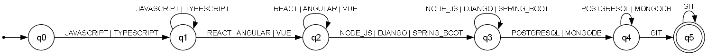
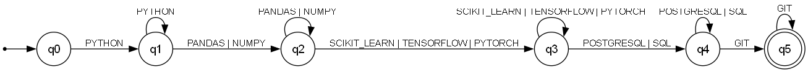
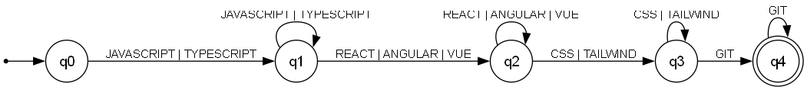
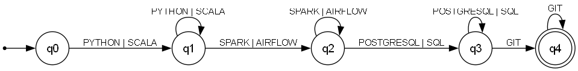

# Qualification Pattern Recognition — Finite Automata

Formal definition of the four profile automata implemented with
[pyformlang](https://pyformlang.readthedocs.io/) in
[`src/classifier.py`](../src/classifier.py). This is Stage 3 of the ResumeLens
pipeline: it receives the **normalized and canonically sorted** qualification
sequence produced by Stage 2 ([`transducers.md`](transducers.md)) and decides
whether the résumé satisfies the accepted pattern of a professional profile
(FR-02, FR-03). Every résumé is evaluated by the four automata, so zero, one or
several profiles may accept it (FR-16).

## Design of the profile patterns

Every profile is described as an **ordered list of qualification categories**
(e.g. *language → frontend → backend → database → version control*). A résumé
satisfies the profile when its qualification sequence contains **at least one
symbol of every category, in category order**. Because Stage 2 sorts the
qualifications with the profile's canonical order (`CANONICAL_ORDERS`) and
removes duplicates, the input sequence always arrives category by category and
each symbol appears at most once.

All four automata share the same shape:

- State `qᵢ` means *"the first i categories are already covered"*.
- From `qᵢ`, **any** symbol of category *i+1* advances to `qᵢ₊₁`
  (the alternatives of the category — e.g. `REACT | ANGULAR | VUE` — are
  parallel transitions, as in the example automaton of the assignment).
- At `qᵢ₊₁`, additional symbols of the category just covered **self-loop**,
  so an over-qualified candidate (e.g. both `REACT` and `VUE`) is still
  accepted.
- Any other symbol has no transition defined: the run dies and the sequence is
  **rejected** (missing category, or category out of order).

**Recognized language.** If C₁, …, Cₖ are the symbol sets of the categories of a
profile, in order, its automaton recognizes

L(M) = C₁⁺ C₂⁺ ⋯ Cₖ⁺

the sequences made of one or more symbols of each category, category after
category. Because stage 2 sorts and deduplicates, the sequence a DFA receives is
in this language exactly when the résumé has at least one qualification of
every category of the profile.

The patterns are data (`PROFILE_PATTERNS` in
[`src/profiles.py`](../src/profiles.py), the same data stage 2 sorts with) and
a single generic constructor builds the DFA for each profile, as required by
FR-03.

## Type of automaton

All four automata are **deterministic finite automata (DFA)**, justified from
the definition below:

- δ is a **partial function** Q × Σ → Q: for every pair (state, symbol) there
  is **at most one** destination state. The symbol sets of consecutive
  categories are disjoint, so a self-loop and an advancing transition never
  share a symbol.
- There are **no ε/λ-transitions** and a **single initial state** q₀.

A partial δ is the standard shortcut for a DFA whose missing transitions all
go to an implicit dead (trap) state; `pyformlang`'s
`DeterministicFiniteAutomaton.accepts` rejects exactly in that case. The
automata can be made total by adding the trap state explicitly without
changing the recognized language.

---

## 1. Full Stack Developer

**Pattern:** language (JS/TS) → frontend framework → backend technology →
database (SQL or NoSQL) → version control.

**M₁ = (Q, Σ, δ, q₀, F)** with

- **Q** = {q₀, q₁, q₂, q₃, q₄, q₅}
- **Σ** = {JAVASCRIPT, TYPESCRIPT, REACT, ANGULAR, VUE, NODE_JS, DJANGO,
  SPRING_BOOT, POSTGRESQL, MONGODB, SQL, GIT}
- **q₀** = q₀ (initial state)
- **F** = {q₅}
- **δ** (transition function; every listed symbol of a row behaves the same):

| State | JAVASCRIPT, TYPESCRIPT | REACT, ANGULAR, VUE | NODE_JS, DJANGO, SPRING_BOOT | POSTGRESQL, MONGODB, SQL | GIT |
|---|---|---|---|---|---|
| → q₀ | q₁ | — | — | — | — |
| q₁ | q₁ | q₂ | — | — | — |
| q₂ | — | q₂ | q₃ | — | — |
| q₃ | — | — | q₃ | q₄ | — |
| q₄ | — | — | — | q₄ | q₅ |
| *q₅ | — | — | — | — | q₅ |

**Meaning of the states:** q₁ = language covered, q₂ = frontend covered,
q₃ = backend covered, q₄ = database covered, q₅ = full pattern satisfied.

Example — `JAVASCRIPT, REACT, NODE_JS, POSTGRESQL, GIT` (Wednesday Addams):
q₀ → q₁ → q₂ → q₃ → q₄ → q₅ ∈ F → **ACCEPTED**.

## 2. Machine Learning Engineer

**Pattern:** Python → data-processing library → ML framework → database →
version control.

**M₂ = (Q, Σ, δ, q₀, F)** with

- **Q** = {q₀, q₁, q₂, q₃, q₄, q₅}
- **Σ** = {PYTHON, PANDAS, NUMPY, SCIKIT_LEARN, TENSORFLOW, PYTORCH,
  POSTGRESQL, SQL, GIT}
- **q₀** = q₀, **F** = {q₅}
- **δ**:

| State | PYTHON | PANDAS, NUMPY | SCIKIT_LEARN, TENSORFLOW, PYTORCH | POSTGRESQL, SQL | GIT |
|---|---|---|---|---|---|
| → q₀ | q₁ | — | — | — | — |
| q₁ | q₁ | q₂ | — | — | — |
| q₂ | — | q₂ | q₃ | — | — |
| q₃ | — | — | q₃ | q₄ | — |
| q₄ | — | — | — | q₄ | q₅ |
| *q₅ | — | — | — | — | q₅ |

Example of the assignment — `PYTHON, PANDAS, TENSORFLOW, POSTGRESQL, GIT`:
q₀ → q₁ → q₂ → q₃ → q₄ → q₅ ∈ F → **ACCEPTED**.

Example — `PYTHON, PANDAS, NUMPY, SCIKIT_LEARN, TENSORFLOW, SQL, GIT`
(Mary Jane Watson): q₀ → q₁ → q₂ → q₂ → q₃ → q₃ → q₄ → q₅ ∈ F →
**ACCEPTED** (the second library and framework are absorbed by self-loops).

## 3. Frontend Developer (team-defined, software engineering)

**Pattern:** language (JS/TS) → frontend framework → styling → version
control.

**M₃ = (Q, Σ, δ, q₀, F)** with

- **Q** = {q₀, q₁, q₂, q₃, q₄}
- **Σ** = {JAVASCRIPT, TYPESCRIPT, REACT, ANGULAR, VUE, CSS, TAILWIND, GIT}
- **q₀** = q₀, **F** = {q₄}
- **δ**:

| State | JAVASCRIPT, TYPESCRIPT | REACT, ANGULAR, VUE | CSS, TAILWIND | GIT |
|---|---|---|---|---|
| → q₀ | q₁ | — | — | — |
| q₁ | q₁ | q₂ | — | — |
| q₂ | — | q₂ | q₃ | — |
| q₃ | — | — | q₃ | q₄ |
| *q₄ | — | — | — | q₄ |

Example — `JAVASCRIPT, TYPESCRIPT, VUE, TAILWIND, GIT` (Peter Parker):
q₀ → q₁ → q₁ → q₂ → q₃ → q₄ ∈ F → **ACCEPTED**.

## 4. Data Engineer (team-defined, AI/data)

**Pattern:** language (Python/Scala) → data pipeline technology → database →
version control.

**M₄ = (Q, Σ, δ, q₀, F)** with

- **Q** = {q₀, q₁, q₂, q₃, q₄}
- **Σ** = {PYTHON, SCALA, SPARK, AIRFLOW, POSTGRESQL, SQL, GIT}
- **q₀** = q₀, **F** = {q₄}
- **δ**:

| State | PYTHON, SCALA | SPARK, AIRFLOW | POSTGRESQL, SQL | GIT |
|---|---|---|---|---|
| → q₀ | q₁ | — | — | — |
| q₁ | q₁ | q₂ | — | — |
| q₂ | — | q₂ | q₃ | — |
| q₃ | — | — | q₃ | q₄ |
| *q₄ | — | — | — | q₄ |

Example — `PYTHON, SPARK, AIRFLOW, POSTGRESQL, GIT` (Lisa Simpson):
q₀ → q₁ → q₂ → q₂ → q₃ → q₄ ∈ F → **ACCEPTED**.

Rejected run — `PYTHON, SQL, GIT` (Mary Jane Watson's sequence for this
profile): q₀ → q₁, and δ(q₁, SQL) is undefined (the DFA waits for SPARK or
AIRFLOW) → **REJECTED**.

---

## Classifying a résumé

`classify(tokens)` sorts the normalized tokens with the canonical order of each
profile and runs its automaton, so every résumé gets four verdicts. For the
sample résumés of [`data/resumes/`](../data/resumes/):

| Résumé | FULL_STACK_DEVELOPER | MACHINE_LEARNING_ENGINEER | FRONTEND_DEVELOPER | DATA_ENGINEER |
|---|---|---|---|---|
| Wednesday Addams | **ACCEPTED** | REJECTED | REJECTED | REJECTED |
| Mary Jane Watson | REJECTED | **ACCEPTED** | REJECTED | REJECTED |
| Peter Parker | **ACCEPTED** | REJECTED | **ACCEPTED** | REJECTED |
| Lisa Simpson | REJECTED | REJECTED | REJECTED | **ACCEPTED** |
| Bart Simpson | REJECTED | REJECTED | REJECTED | REJECTED (UNQUALIFIED) |

`python src/pipeline.py data/resumes/*.txt` prints the sequence and the run of
every automaton for each résumé.

## Implementation and diagrams

- Implementation: `create_profile_dfa`, `evaluate_resume_profile`, `classify`
  and `trace` (the states of a run) in [`src/classifier.py`](../src/classifier.py),
  using `pyformlang.finite_automaton.DeterministicFiniteAutomaton`.
- The transition diagrams above are generated from `PROFILE_PATTERNS` by
  `python src/diagrams.py`, which writes the `.dot` sources in
  [`diagrams/`](diagrams/) and renders them with Graphviz.
- `tests/test_classifier.py` checks the examples of this document and the size
  and determinism of each automaton.
