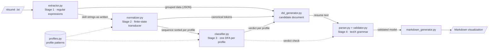

# Design

Design of the ResumeLens modules: the architecture, the functions of every module
with their inputs and outputs, the main design decisions and the traceability of
the requirements ([`requirements.md`](requirements.md)).

## Architecture

`pipeline.run_pipeline` chains the four stages; the Streamlit UI (`app.py`), the
command line (`pipeline.py`) and the tests call it. A `.resume` file written by
hand enters directly at stage 4 (`parser.py`, `validator.py`,
`markdown_generator.py`).

## Modules

### `src/profiles.py` — profile data

| Name | Type | Content |
|---|---|---|
| `PROFILE_PATTERNS` | `dict[str, list[tuple[str, list[str]]]]` | profile → ordered categories, each with its canonical tokens |
| `PROFILE_NAMES` | `dict[str, str]` | profile → display name |
| `PROFILES` | `list[str]` | the four profile names, in DSL order |

### `src/extractor.py` — Stage 1, regular expressions ([`regular_expressions.md`](regular_expressions.md))

| Function | Input | Output |
|---|---|---|
| `extract_resume_entities(text_content)` | résumé text (`str`) | `dict` with `personal`, `contact`, `skills` (by category, plus `unrecognized`), `technologies`, `other_qualifications`, `academic_qualifications`, `experience_years`, `experience`, `education`, `languages` |
| `save_extracted_data(extracted_data, output_path)` | that `dict`, a path | JSON file (creates the folder) |
| `unrecognized_skills(text)` | résumé text | items of the skills list that are not a known skill |
| `split_sections(text)` | résumé text | `{section name: text}` for the headed sections |
| `extract_entries(block, with_tasks)` | text of a section | entries `{title, organization, start, end[, tasks]}` |
| `unique(items)` | iterable | list without repetitions, first occurrence kept |

Compiled patterns: `NAME`, `FIELD`, `EMAIL`, `PHONE`, `LINKEDIN`, `SKILL_PATTERNS`
→ `SKILLS`, `SKILLS_LIST`, `OTHER_QUALIFICATIONS`, `ACADEMIC`, `YEARS`, `SECTION`,
`ENTRY`, `TASK`, `LANGUAGE`.

### `src/normalizer.py` — Stage 2, finite-state transducer ([`transducers.md`](transducers.md))

| Function / constant | Input | Output |
|---|---|---|
| `VARIANTS` | — | canonical token → spellings (Γ and Σ of the transducer) |
| `GLOBAL_ORDER`, `CANONICAL_ORDERS` | — | global order of the tokens; canonical order of each profile |
| `clean(raw)` | string as written | input symbol (lowercase, single spaces) |
| `create_normalization_fst()` | — | `pyformlang.fst.FST` (also built once as `NORMALIZATION_FST`) |
| `translate(raw)` | string as written | canonical token, or `None` if the transducer rejects it |
| `normalize(raw_technologies)` | list of strings | `(tokens, unknown)`: tokens without duplicates in order of appearance, rejected strings |
| `sort_for_profile(tokens, profile_type)` | tokens, profile | the tokens of the profile's alphabet in its canonical order |
| `normalize_qualifications(raw_technologies, profile_type)` | strings, profile | `sort_for_profile(normalize(...)[0], profile)` |

### `src/classifier.py` — Stage 3, finite automata ([`automata.md`](automata.md))

| Function | Input | Output |
|---|---|---|
| `create_profile_dfa(profile_type)` | profile | `pyformlang` `DeterministicFiniteAutomaton` built from its pattern |
| `evaluate_resume_profile(normalized_qualifications, profile_type)` | sorted sequence, profile | `bool`: the DFA accepts the sequence |
| `classify(normalized_tokens)` | canonical tokens | `{profile: bool}` for the four profiles |
| `trace(sequence, profile_type)` | sorted sequence, profile | states visited, until the first missing transition |

### `src/dsl_generator.py` — from the pipeline results to the DSL

| Function | Input | Output |
|---|---|---|
| `build_resume(data, tokens, verdicts)` | stage-1 `dict`, canonical tokens, `{profile: bool}` | `.resume` text that follows `grammar/resume.tx` |
| `missing_information(data, tokens)` | stage-1 `dict`, tokens | mandatory parts the résumé lacks |
| `quote(text)` | text | DSL `STRING` |

### `src/parser.py`, `src/validator.py`, `src/markdown_generator.py` — Stage 4, textX ([`grammar.md`](grammar.md), [`metamodel.md`](metamodel.md))

| Function | Input | Output |
|---|---|---|
| `parser.get_metamodel()` | — | textX metamodel of `grammar/resume.tx` (lexical and syntactic rules) |
| `parser.parse_file(path, metamodel)` | `.resume` path | model (`CandidateProfile`) or `TextXSyntaxError` |
| `validator.get_validating_metamodel()` | — | metamodel with the semantic checks as object processors |
| `validator.check_candidate`, `check_verdicts`, `check_header`, `check_contact`, `check_skills`, `check_period`, `check_classification` | a model object | nothing, or `TextXSemanticError` with its line and column |
| `validator.validate_file(path, metamodel)` | `.resume` path | `None` if valid, else the error |
| `validator.collect_cases()` | — | `(path, should_be_valid)` for `examples/`, `tests/valid/`, `tests/invalid/` |
| `markdown_generator.generate_markdown(c)` | validated model | Markdown text |

As scripts: `python src/parser.py <file>` prints the model or the error;
`python src/validator.py` runs the validation suite; `python src/markdown_generator.py
<file>` writes `output/<name>.md`.

### `src/pipeline.py`, `src/app.py` — pipeline and user interface

| Function | Input | Output |
|---|---|---|
| `pipeline.run_pipeline(text, metamodel=None)` | résumé text | `dict` with `extracted`, `translations`, `tokens`, `unknown`, `sequences`, `traces`, `verdicts`, `missing`, `document`, `error`, `markdown` |
| `pipeline.main(paths)` | résumé files | prints every stage; writes `output/pipeline/<name>.json`, `.resume` and `.md` |
| `app.py` (Streamlit) | résumé chosen, pasted or uploaded | one tab per stage, downloads of the JSON, the `.resume` and the Markdown |

### `src/diagrams.py` — diagrams

| Function | Input | Output |
|---|---|---|
| `dfa_dot(profile)` | profile | Graphviz source of its DFA |
| `fst_dot()` | — | Graphviz source of the transducer |
| `main()` | — | `docs/diagrams/*.dot` (metamodel, parse trees, automata) and their PNG when Graphviz is installed |

## Data flow example

[`data/resumes/wednesday.txt`](../data/resumes/wednesday.txt) through the pipeline:

| Stage | Output |
|---|---|
| 1 · extraction | name `Wednesday Addams`, e-mail, LinkedIn, 3 years of experience, one position with two tasks, one degree; skills `JS`, `React.js`, `NodeJS`, `Postgres`, `Git`, `React` |
| 2 · normalization | `JAVASCRIPT`, `REACT`, `NODE_JS`, `POSTGRESQL`, `GIT`; nothing unknown |
| 3 · recognition | Full Stack: `JAVASCRIPT, REACT, NODE_JS, POSTGRESQL, GIT`, q₀ → q₁ → q₂ → q₃ → q₄ → q₅, ACCEPTED; the other three REJECTED |
| 4 · document | the text of [`examples/resume_01.resume`](../examples/resume_01.resume), valid |
| visualization | [`output/resume_01.md`](../output/resume_01.md) |

## Design decisions

1. **Profiles are data.** One pattern per profile in `profiles.py`; the canonical
   orders of stage 2 and the four DFAs of stage 3 are derived from it by the same
   code (FR-03). A new profile is a new entry, not new code.
2. **One vocabulary across stages.** The output alphabet Γ of the transducer is the
   input alphabet of the automata and the `CANON` skill vocabulary of the DSL; tests
   check that the three agree.
3. **Word-level transducer.** Stage 1 delimits the strings, so each string is one
   input symbol of a two-state transducer.
4. **Unknown strings are reported, not guessed.** A string without a transition is
   listed as unknown and never becomes a token (FR-12).
5. **Order independence.** Each automaton reads the projection of the tokens on its
   alphabet, sorted in its canonical order, so the verdict does not depend on how
   the résumé lists the skills (FR-14).
6. **Partial DFAs with self-loops.** Each automaton recognizes C₁⁺ C₂⁺ ⋯ Cₖ⁺: a
   missing category or one out of order kills the run, extra qualifications of a
   category loop. Consecutive categories are disjoint, so the automata are
   deterministic.
7. **Three validation levels.** textX checks the lexical and syntactic rules while
   parsing; object processors check what the grammar cannot express, including that
   every verdict is the one its stage-3 automaton gives for the listed skills.
8. **Nothing is invented.** A mandatory part missing from the résumé is written
   empty, reported as missing, and the document is rejected as incomplete.
9. **One pipeline function.** The UI, the command line and the tests run the same
   `run_pipeline`, so what the tests check is what the user sees.

## Requirements traceability

| Requirement | Module | Tests |
|---|---|---|
| FR-01 text or file input | `app.py`, `pipeline.py` | `test_app.py` |
| FR-02, FR-03 four profiles as data | `profiles.py` | `test_classifier.py` |
| FR-04 complete pipeline | `pipeline.py` | `test_pipeline.py` |
| FR-05 – FR-09 extraction | `extractor.py` | `test_extractor.py` |
| FR-10 – FR-14 normalization | `normalizer.py` | `test_normalizer.py` |
| FR-15 – FR-17 recognition | `classifier.py` | `test_classifier.py` |
| FR-18 candidate document | `dsl_generator.py` | `test_pipeline.py` |
| FR-19 – FR-22 DSL, validation, Markdown | `parser.py`, `validator.py`, `markdown_generator.py` | `test_dsl.py`, `python src/validator.py` |
| FR-23 UI with every stage | `app.py` | `test_app.py` |
| FR-24 automated tests | `tests/` | [`test_cases.md`](test_cases.md) |
