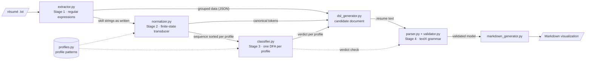

# Design

The functional requirements of ResumeLens, the modules that implement them with their
functions, inputs and outputs, and the main design decisions.

## Requirements

- FR-01 The system shall accept a résumé as plain text (file or pasted text).
- FR-02 The system shall support four profiles: Full Stack Developer, Machine Learning Engineer, Frontend Developer and Data Engineer.
- FR-03 The system shall process all four profiles through a single general pipeline, with each profile defined as data (normalization rules, canonical order, automaton) rather than as a separate implementation.
- FR-04 The system shall run every résumé through the complete pipeline before reporting any profile result.
- FR-05 The system shall extract, using regular expressions implemented with Python's re module: contact information, programming languages, frameworks and libraries, databases, academic qualifications, professional experience, tools and technologies, and other profile-relevant qualifications.
- FR-06 The system shall extract multi-word and punctuated variants (e.g., "scikit learn", "Tensor Flow", "React.js") as single items.
- FR-07 The system shall extract years of experience and descriptive phrases that map to non-tool qualifications (e.g., machine-learning model development).
- FR-08 The extraction stage shall output raw strings exactly as written, without resolving equivalences or evaluating profiles.
- FR-09 The system shall store extracted information, grouped by category, in a file or data structure.
- FR-10 The system shall transform each extracted string into its canonical token using finite-state transducers implemented with pyformlang.
- FR-11 The transducers shall cover team-proposed variants (case, abbreviations, separators, suffixes such as ".js") beyond the assignment's examples.
- FR-12 The system shall handle strings not recognized by any transducer in a defined way (discard or tag as unknown) without failing.
- FR-13 The system shall remove duplicate canonical tokens produced by different variants of the same qualification.
- FR-14 The system shall sort normalized tokens according to each profile's canonical order before recognition.
- FR-15 For each profile, the system shall evaluate the sorted sequence with that profile's finite automaton (DFA, NFA or ε-NFA) implemented with pyformlang and output ACCEPTED or REJECTED.
- FR-16 The system shall report every profile whose automaton accepts, allowing zero, one, or multiple accepted profiles per résumé.
- FR-17 The system shall not rank candidates or issue hiring decisions.
- FR-18 The system shall generate a candidate-profile document in the team's DSL containing personal information, contact information, one or more experience entries, one or more education entries, normalized skills, and the result for each accepted profile.
- FR-19 The system shall parse and validate DSL documents with a textX grammar.
- FR-20 The system shall reject DSL documents that violate lexical or syntactic rules and display an error message.
- FR-21 The system shall accept DSL documents loaded from external files, not only self-generated ones.
- FR-22 The system shall generate a short HTML or Markdown visualization from each validated DSL document.
- FR-23 The system shall provide a UI to load a résumé, run the pipeline, and display each stage's output: extracted strings, normalized tokens, sorted sequence, per-profile result, DSL document, and visualization.
- FR-24 The system shall include automated tests for each stage, covering the two reference résumés, positive and negative cases per profile, and invalid DSL documents.

## Architecture

`pipeline.run_pipeline` chains the four stages. The web interface (`app.py`), the
command line (`pipeline.py`) and the tests call it. A `.resume` file written by hand
enters directly at stage 4 (`parser.py`, `validator.py`, `markdown_generator.py`).

## Modules

### `profiles.py`: the four profiles

| Name | Content |
|---|---|
| `PROFILE_PATTERNS` | profile → ordered list of (category, canonical tokens) |
| `PROFILE_NAMES` | profile → display name |
| `PROFILES` | the four profile names |

### `extractor.py`: stage 1, regular expressions

| Function | Input | Output |
|---|---|---|
| `extract_resume_entities(text)` | résumé text | `dict` with `personal`, `contact`, `skills` (by category, plus `unrecognized`), `technologies`, `other_qualifications`, `academic_qualifications`, `experience_years`, `experience`, `education`, `languages` |
| `save_extracted_data(data, path)` | that `dict`, a path | JSON file |
| `split_sections(text)` | résumé text | `{section: text}` for the headed sections |
| `extract_entries(section, with_tasks)` | text of a section | entries `{title, organization, start, end[, tasks]}` |
| `extract_languages(section)` | text of the languages section | `[{name, level}]` |
| `unrecognized_skills(text)` | résumé text | items of the skills list that no pattern recognizes |

The patterns are explained in [`regular_expressions.md`](regular_expressions.md).

### `normalizer.py`: stage 2, finite-state transducer

| Function / constant | Input | Output |
|---|---|---|
| `VARIANTS` | | canonical token → spellings (Γ and Σ of the transducer) |
| `GLOBAL_ORDER` | | the canonical tokens, in the order the document lists them |
| `create_normalization_fst()` | | `pyformlang` `FST`, built once as `NORMALIZATION_FST` |
| `translate(raw)` | string as written | canonical token, or `None` if the transducer rejects it |
| `normalize(raw_technologies)` | strings as written | `(tokens, unknown)`, both without duplicates |
| `canonical_order(profile)` | profile | its tokens, category by category |
| `sort_for_profile(tokens, profile)` | tokens, profile | the tokens of the profile, in its canonical order |

### `classifier.py`: stage 3, finite automata

| Function | Input | Output |
|---|---|---|
| `create_profile_dfa(profile)` | profile | `pyformlang` `DeterministicFiniteAutomaton`, built once per profile in `PROFILE_DFAS` |
| `evaluate_resume_profile(sequence, profile)` | sorted tokens, profile | `True` if the DFA accepts the sequence |
| `classify(tokens)` | canonical tokens | `{profile: bool}` for the four profiles |
| `trace(sequence, profile)` | sorted tokens, profile | states visited, until a missing transition |

### Stage 4: candidate profile DSL (textX)

| Function | Input | Output |
|---|---|---|
| `dsl_generator.build_resume(data, tokens, verdicts)` | results of stages 1 to 3 | text of the `.resume` document |
| `dsl_generator.missing_information(data, tokens)` | results of stages 1 and 2 | mandatory parts the résumé lacks |
| `parser.get_metamodel()` | | metamodel of `grammar/resume.tx` (lexical and syntactic rules) |
| `parser.parse_file(path, metamodel)` | `.resume` file | model (`CandidateProfile`) or `TextXSyntaxError` |
| `validator.get_validating_metamodel()` | | metamodel with the semantic checks (`check_*` functions) |
| `validator.validate_file(path, metamodel)` | `.resume` file | `None` if valid, otherwise the error |
| `validator.collect_cases()` | | `(path, should be valid)` for `examples/`, `tests/valid/` and `tests/invalid/` |
| `markdown_generator.generate_markdown(candidate)` | valid model | Markdown text |

As scripts: `python src/parser.py <file>` prints the model or the error,
`python src/validator.py` checks every DSL document of the project and
`python src/markdown_generator.py <file>` writes `output/<name>.md`.

### Pipeline, interface and diagrams

| Function | Input | Output |
|---|---|---|
| `pipeline.run_pipeline(text, metamodel)` | résumé text | `dict` with `extracted`, `translations`, `tokens`, `unknown`, `sequences`, `verdicts`, `traces`, `missing`, `document`, `error`, `markdown` |
| `pipeline.main(paths)` | résumé files | prints every stage; writes `output/pipeline/<name>.json`, `.resume` and `.md` |
| `app.py` | résumé chosen, pasted or uploaded | one tab per stage |
| `diagrams.main()` | | `docs/diagrams/`: metamodel, parse trees, automata and transducer |

## Data flow example

[`data/resumes/wednesday.txt`](../data/resumes/wednesday.txt) through the pipeline:

| Stage | Output |
|---|---|
| 1. Extraction | name `Wednesday Addams`, e-mail, LinkedIn, 3 years of experience, one position with two tasks, one degree; skills `JS`, `React.js`, `NodeJS`, `Postgres`, `Git`, `React` |
| 2. Normalization | `JAVASCRIPT`, `REACT`, `NODE_JS`, `POSTGRESQL`, `GIT`; nothing unknown |
| 3. Recognition | Full Stack: `JAVASCRIPT, REACT, NODE_JS, POSTGRESQL, GIT`, q₀ → q₁ → q₂ → q₃ → q₄ → q₅, ACCEPTED; the other three REJECTED |
| 4. Document | the text of [`examples/resume_01.resume`](../examples/resume_01.resume), valid |
| Visualization | [`output/resume_01.md`](../output/resume_01.md) |

## Design decisions

1. **Profiles are data.** The canonical orders of stage 2 and the four DFAs of stage 3
   are built from `PROFILE_PATTERNS` by the same code. A new profile is a new entry,
   not new code.
2. **One vocabulary.** The output alphabet Γ of the transducer is the alphabet of the
   automata and the skill vocabulary of the DSL.
3. **Word-level transducer.** Stage 1 already delimits the strings, so each string is
   one input symbol of a two-state transducer.
4. **Unknown strings are reported, not guessed.** A string without a transition never
   becomes a token.
5. **Order independence.** Each automaton reads only the tokens of its profile, in the
   canonical order, so the verdict does not depend on how the résumé lists the skills.
6. **Partial DFAs with self-loops.** Each automaton recognizes C₁⁺ C₂⁺ ⋯ Cₖ⁺: a missing
   category kills the run, and extra qualifications of a category loop.
7. **Three validation levels.** textX checks the lexical and syntactic rules while
   parsing; the validator checks on the model what the grammar cannot express,
   including that every verdict is the one its automaton gives.
8. **Nothing is invented.** A mandatory part missing from the résumé is written empty,
   and the document is rejected as incomplete.

## Requirements traceability

| Requirement | Module | Tests |
|---|---|---|
| FR-01 text or file input | `app.py`, `pipeline.py` | |
| FR-02, FR-03 four profiles as data | `profiles.py` | `test_classifier.py` |
| FR-04 complete pipeline | `pipeline.py` | `test_pipeline.py` |
| FR-05 to FR-09 extraction | `extractor.py` | `test_extractor.py` |
| FR-10 to FR-14 normalization | `normalizer.py` | `test_normalizer.py` |
| FR-15 to FR-17 recognition | `classifier.py` | `test_classifier.py` |
| FR-18 candidate document | `dsl_generator.py` | `test_pipeline.py` |
| FR-19 to FR-22 DSL, validation, Markdown | `parser.py`, `validator.py`, `markdown_generator.py` | `test_dsl.py`, `python src/validator.py` |
| FR-23 interface with every stage | `app.py` | |
| FR-24 automated tests | `tests/` | [`test_cases.md`](test_cases.md) |
