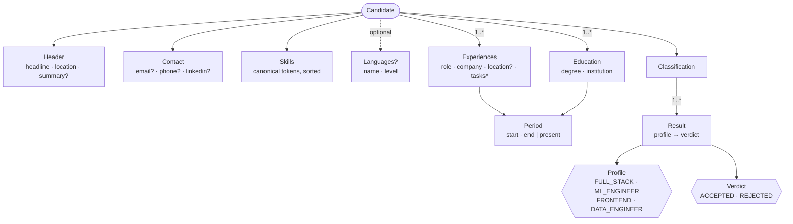
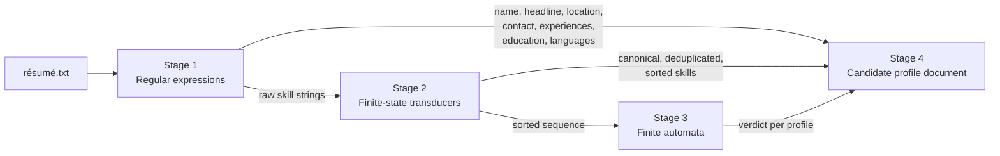

# Domain

Domain definition of the ResumeLens candidate profile language. This document fixes
*what* the DSL talks about, the concepts of a screened candidate,before the grammar
([`grammar.md`](grammar.md)) fixes *how* they are written and the metamodel
([`metamodel.md`](metamodel.md)) fixes *how* they are represented in memory.

## Problem domain

ResumeLens is a résumé screening system. Its input is a résumé in plain text; its output
is a structured description of the candidate together with a formal verdict, per
professional profile, on whether the qualifications explicitly written in the résumé
satisfy that profile's pattern (FR-02, FR-15, FR-17).

The DSL covers the **output side** of the system. It is the "candidate specification
language": a textual, machine-validated representation of everything ResumeLens learned
about one candidate. It is not an input format for raw résumés and it does not encode how
extraction, normalization or recognition work, only their results (FR-18).

The vocabulary comes from how résumés are actually organized. A **LinkedIn-style** profile
was used as the reference layout: a header (name, headline, location, summary), a contact
block, a skills list, spoken languages, a dated list of positions with responsibilities,
and a dated list of degrees. ResumeLens adds one concept of its own: the classification
result.

## Core concepts

### Candidate (`CandidateProfile`)

The root concept: One document describes exactly one candidate, identified by name. A
candidate *has* a header, contact information, skills, optionally languages, one or more
experiences, one or more degrees, and a classification.

### Header

The candidate's self-description at the top of a résumé: a **headline** (the one-line
title, e.g. "Web Developer"), a **location** (city/country as written), and an optional
free-text **summary**. The header is descriptive only and nothing in it is evaluated by the
profile automata.

### Contact

Means of reaching the candidate: **email**, **phone**, **LinkedIn URL**, each is optional
because résumés frequently omit one or more, but each one that is present must have a
valid shape, this is where stage 1's contact-extraction patterns (FR-05) are re-checked
by the grammar's lexical tokens.

### Qualification / Skill

A technology, tool or capability the candidate claims to have. In the domain of the DSL a
skill is **always canonical**: the stage-2 transducers have already collapsed
`JS`, `Javascript`, `JavaScript` into `JAVASCRIPT` (FR-10), duplicates are removed
(FR-13) and the list is in the canonical order of the profile being evaluated (FR-14).
The DSL therefore never sees `React.js`; it sees `REACT`.

The known canonical vocabulary, grouped by the categories the four profiles use:

| Category | Canonical tokens |
|---|---|
| Programming language | `JAVASCRIPT` `TYPESCRIPT` `PYTHON` `SCALA` |
| UI framework | `REACT` `ANGULAR` `VUE` |
| Styling | `CSS` `TAILWIND` |
| Backend | `NODE_JS` `DJANGO` `SPRING_BOOT` |
| Data libraries | `PANDAS` `NUMPY` |
| ML framework | `SCIKIT_LEARN` `TENSORFLOW` `PYTORCH` |
| Pipelines | `SPARK` `AIRFLOW` |
| Database | `POSTGRESQL` `MONGODB` `SQL` |
| Version control | `GIT` |

### Language (spoken)

A natural language the candidate speaks, with a proficiency **level** drawn from a fixed
scale (`native`, `full_professional`, `professional`, `basic`). Distinct from a
*programming* language, which is a skill so the section is optional.

### Experience

One professional position: **role**, **company**, a **period**, an optional **location**
and an optional list of **tasks** (free-text responsibilities). A candidate may have many;
order in the document is the order in the résumé (usually most recent first).

### Degree (Education)

One academic record: **degree** title, **institution**, and a **period**. A candidate may
have many.

### Period

A time interval with a **start** date and an **end** date, where the end may be the
literal `present` for ongoing positions or studies. Dates are `YYYY-MM` or `YYYY-MM-DD`.
`Period` is a value concept reused by both `Experience` and `Degree`.

### Profile

One of the professional profiles ResumeLens evaluates (FR-02). Four are supported:

| Profile | Pattern (canonical order) |
|---|---|
| `FULL_STACK_DEVELOPER` | Frontend - Backend - Database - Version control |
| `MACHINE_LEARNING_ENGINEER` | Language - Data - ML framework - Database - Version control |
| `FRONTEND_DEVELOPER` | Language - UI framework - Styling - Version control |
| `DATA_ENGINEER` | Language - Pipelines - Database - Version control |

The grammar additionally admits the literal `UNQUALIFIED`, intended to express that no
profile pattern was satisfied.

### Verdict

The output of a profile's automaton for this candidate's sorted skill sequence:
`ACCEPTED` or `REJECTED` (FR-15). A verdict is a formal statement about pattern
membership, never a hiring recommendation (FR-17).

### Classification

The set of **results**, one `(profile, verdict)` pair per evaluated profile. Zero, one
or several profiles may be accepted for the same candidate (FR-16).

## Concept map

## Where each concept comes from

| Concept | Produced by | Requirements |
|---|---|---|
| Candidate name, Header, Contact, Experience, Degree, Language | Stage 1 - extraction | FR-05, FR-07, FR-08 |
| Skill (canonical) | Stage 2 - normalization | FR-10, FR-13, FR-14 |
| Classification, Result, Verdict | Stage 3 - recognition | FR-15, FR-16 |
| Whole document | Stage 4 - generation, parsing, validation, visualization | FR-18 – FR-22 |

## Boundaries of the domain

Deliberately **inside**:

- Only information explicitly present in the résumé or produced by the pipeline.
- Repeated, structured records (several experiences, degrees, languages, results).
- Enough structure to render a short HTML/Markdown card of the candidate (FR-22).

Deliberately **outside**:

- Raw, un-normalized skill strings, those belong to the stage 1 to stage 2 interface,
  not to the candidate document.
- Scores, rankings or any comparison between candidates (FR-17).
- Inference of skills not written in the résumé.
- Free-form sections (certifications, publications, hobbies) - can be added later as new
  repeated concepts without changing the existing ones.

