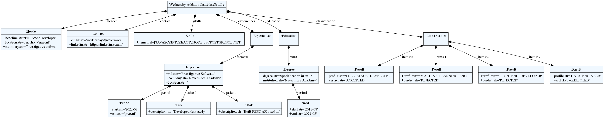

# Metamodel

Metamodel generated by textX from [`grammar/resume.tx`](../grammar/resume.tx). The EBNF
behind it is in [`grammar.md`](grammar.md) and the concepts it represents are described
in [`domain.md`](domain.md).

## How the metamodel is obtained

textX works the way the course slides describe: from a single grammar it builds, at the
same time, a parser for the language and a *meta-model*, a Python object that knows every
class that can be instantiated while parsing. Each rule in `resume.tx` becomes a class;
each assignment inside a rule (`name=STRING`, `items+=Experience`) becomes an attribute of
that class. We never write these classes by hand.

Building the metamodel is one call, and exporting it to a picture is one command:

```python
from textx import metamodel_from_file
resume_mm = metamodel_from_file('resume.tx')
```

```bash
textx generate resume.tx --target dot
dot -Tpng -O resume.dot
```

The full, runnable walkthrough is in the project notebook
(`src/notebooks/ResumeLens_DSL_metamodel.ipynb`); the pictures in this document are its output.

## The metamodel


Reading the diagram from the top: the root class is **`CandidateProfile`**, created by the
first rule of the grammar. It carries a single plain attribute, `name`, and seven
*containment* arrows (the black diamonds), one for each section the grammar requires in a
candidate document. Six of them are mandatory (`header`, `contact`, `skills`,
`experiences`, `education`, `classification`) and one, `languages`, is optional, because
the grammar writes it as `languages=Languages?`. Every object below the root is created
*inside* its parent while parsing and cannot exist on its own; textX records this by
giving each child a `parent` attribute pointing back to its container.

**`Header`** and **`Contact`** are flat: three string attributes each, with no further
nesting. Their difference is where the strings come from. `Header` uses the built-in
`STRING` type, so `headline`, `location` and `summary` are quoted text. `Contact` uses our
own lexical rules, `EMAIL`, `PHONE` and `URL`, which is why the diagram shows those names
as attribute types. They are *match rules*: they do not create objects, they only
constrain the shape of the text and hand back a string. That is also why they appear in
the table at the top right of the picture together with `DATE`, `CANON`, `Level`,
`Profile`, `Verdict` and `EndDate`, each next to the regular expression or the list of
literals it accepts. A `Level` or a `Verdict` is a string in the model, not a class.

**`Skills`** holds one attribute, `items`, typed `list[Qualification]`. Since
`Qualification` is itself a match rule (`CANON`, an uppercase identifier), the list ends
up containing plain strings such as `JAVASCRIPT` or `NODE_JS`: exactly the canonical
tokens produced by the stage-2 transducers. The grammar guarantees the list is never empty
(`items+=Qualification[',']`).

The next four classes, **`Languages`**, **`Experiences`**, **`Education`** and
**`Classification`**, follow one pattern. Each is a *section wrapper*: it owns a single
`items` list, marked `1..*` in the diagram, and nothing else. The wrapper exists so the
document can group repeated records under a keyword (`experience { … }`), which keeps the
source readable at the cost of one extra level in the object tree. What matters is the
element each list contains:

- `Languages` contains **`Language`** objects, each a `name` and a `level`.
- `Experiences` contains **`Experience`** objects: `role`, `company`, an optional
  `location`, a `period`, and a list of **`Task`** objects that may be empty. `Task` is the
  smallest class in the model, a single `description`.
- `Education` contains **`Degree`** objects: `degree`, `institution` and a `period`.
- `Classification` contains **`Result`** objects, each pairing a `profile` with a
  `verdict`. Both attributes are closed vocabularies, so the parser itself refuses an
  unknown profile name or a verdict other than `ACCEPTED` / `REJECTED`.

**`Period`** deserves its own mention because the diagram shows two arrows pointing at
it, from `Experience` and from `Degree`. This is not a shared object: it is one *class*
reused by two containers. Every experience and every degree owns its own `Period`
instance with a `start` date and an `end` that is either a date or the literal `present`.

Taken together, the metamodel is a strict tree. There are no link references
(`[Rule]` in textX syntax) anywhere in the grammar, so no object points at another object
outside its own containment chain. That simplicity is deliberate: a candidate document is
a description, not a program, and a tree is all it needs.

## A model

A *model* is what the parser produces from a concrete document. Here is the first
reference résumé of the assignment, Wednesday Addams, written in the DSL as the pipeline
emits it after extraction, normalization and recognition
(`examples/resume_01.resume`):

```
// Reference résumé 1 (Integrative Task 1, Full Stack Developer profile) — Wednesday Addams.
candidate "Wednesday Addams" {
    headline: "Full Stack Developer";
    location: "Jericho, Vermont";
    summary: "Investigative software developer with a taste for the macabre.";

    contact {
        email: wednesday@nevermore.edu;
        linkedin: https://linkedin.com/in/wednesday-addams;
    }

    skills {
        JAVASCRIPT, REACT, NODE_JS, POSTGRESQL, GIT
    }

    experience {
        role "Investigative Software Developer" at "Nevermore Academy" from 2022-08 to present {
            - "Developed data analysis tools to investigate unusual events around Nevermore."
            - "Built REST APIs and a React front end for the academy's incident tracker."
        }
    }

    education {
        "Specialization in supernatural investigations" at "Nevermore Academy" from 2018-08 to 2022-05;
    }

    classification {
        FULL_STACK_DEVELOPER -> ACCEPTED;
        MACHINE_LEARNING_ENGINEER -> REJECTED;
        FRONTEND_DEVELOPER -> REJECTED;
        DATA_ENGINEER -> REJECTED;
    }
}
```

Parsing it and exporting the result mirrors the metamodel step:

```python
candidate = resume_mm.model_from_file('resume_01.resume')
```

```bash
textx generate resume_01.resume --grammar resume.tx --target dot
dot -Tpng -O resume_01_tree.dot
```



The picture is the metamodel instantiated. The root is now a concrete object,
`Wednesday Addams:CandidateProfile`, and each arrow carries the attribute name it fills.
Compare it with the metamodel above and the first thing to notice is what is *missing*:
there is no `Languages` node and no `languages` arrow, because the document has no
`languages` section and the attribute is optional. In the Python object that attribute is
simply `None`. The same happens one level down, where the `Experience` shows
`location=''`: the role was written without `in "…"`, so the optional string stays empty.

Everything else is one instance per grammar occurrence. `Header` and `Contact` hold their
strings (the `Contact` has an e-mail and a LinkedIn URL but no `phone`). `Skills` shows its
`items` list already resolved to the five canonical tokens in the Full Stack canonical
order. `Experiences` owns a single `Experience`, labelled `items:0`, which in turn owns a
`Period` ending in `present` and two `Task` objects, `tasks:0` and `tasks:1`. `Education`
owns one `Degree` with its own `Period`, and `Classification` fans out into four `Result`
objects, `items:0` to `items:3`, one per profile, with the verdicts the stage-3 automata
produced.

What we obtain is a plain Python object graph. Nothing in it is textX-specific: it can be
walked with ordinary attribute access,

```python
candidate.skills.items                       # ['JAVASCRIPT', 'REACT', 'NODE_JS', 'POSTGRESQL', 'GIT']
candidate.experiences.items[0].period.end    # 'present'
candidate.languages                          # None
[r.profile for r in candidate.classification.items if r.verdict == 'ACCEPTED']
                                             # ['FULL_STACK_DEVELOPER']
```

and that is exactly what the visualization generator does to produce the candidate's
HTML or Markdown card.
