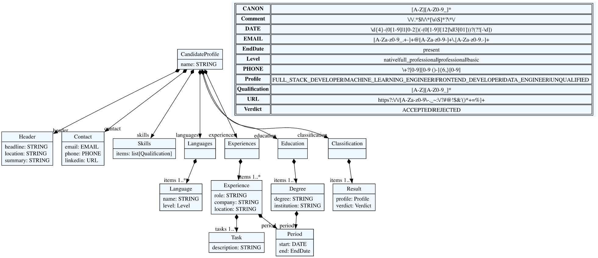
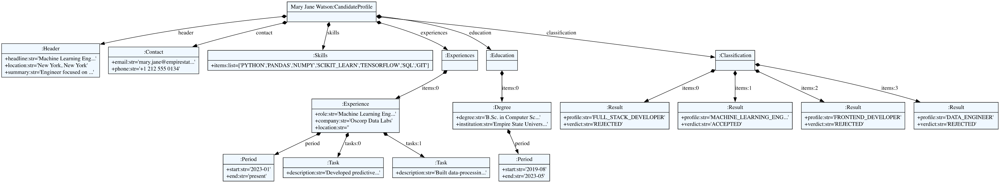
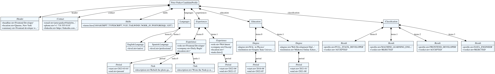

# Metamodel

The metamodel textX generates from [`grammar/resume.tx`](../grammar/resume.tx). The
domain of the language and its EBNF are in [`grammar.md`](grammar.md).

## Grammar, metamodel and model

- The **grammar** (`resume.tx`) defines the language.
- The **metamodel** is what textX builds from the grammar: one class per rule and one
  attribute per assignment in the rule (`name=STRING`, `items+=Experience`). The classes
  are not written by hand.
- A **model** is what the parser builds from one document: objects of those classes.

```python
from textx import metamodel_from_file

resume_mm = metamodel_from_file("grammar/resume.tx")                # metamodel
candidate = resume_mm.model_from_file("examples/resume_01.resume")  # model
```

`python src/diagrams.py` exports both to Graphviz with `textx.export`, which gives the
same diagrams as the textX commands:

```bash
textx generate grammar/resume.tx --target dot
textx generate examples/resume_01.resume --grammar grammar/resume.tx --target dot
```

## The metamodel



The root class is **`CandidateProfile`**, created by the first rule of the grammar. It
has one plain attribute, `name`, and seven *containment* relations (the black diamonds),
one per section of the document. Six of them are mandatory (`header`, `contact`,
`skills`, `experiences`, `education`, `classification`) and `languages` is optional,
because the grammar writes it as `languages=Languages?`. Every object below the root is
created inside its parent, and textX gives it a `parent` attribute that points back to
it.

- **`Header`** has three strings: `headline`, `location` and the optional `summary`.
- **`Contact`** has `email`, `phone` and `linkedin`, typed with the match rules `EMAIL`,
  `PHONE` and `URL`. A match rule does not create objects: it checks the shape of the
  text and gives back a string. The table at the top right of the diagram lists the
  match rules (`DATE`, `CANON`, `Level`, `Profile`, `Verdict`, `EndDate`, …) with the
  regular expression or the literals each one accepts.
- **`Skills`** has `items`, a `list[Qualification]`. `Qualification` is the match rule
  `CANON`, so the list holds strings such as `JAVASCRIPT` or `NODE_JS`: the canonical
  tokens of stage 2. The grammar does not allow an empty list.
- **`Languages`**, **`Experiences`**, **`Education`** and **`Classification`** are
  section wrappers. Each one has a single `items` list (`1..*`) of, respectively:
  - `Language`: `name` and `level`;
  - `Experience`: `role`, `company`, `period`, an optional `location` and a list of
    `Task` objects, each one a `description`;
  - `Degree`: `degree`, `institution` and `period`;
  - `Result`: `profile` and `verdict`, both closed vocabularies, so the parser rejects
    an unknown profile or verdict.
- **`Period`** is used by `Experience` and by `Degree`, but it is not shared: every
  experience and every degree has its own `Period`, with a `start` date and an `end`
  that is a date or `present`.

The metamodel is a tree. The grammar has no references (`[Rule]` in textX), so no object
points to an object outside its own container.

## A model

The first example, Wednesday Addams ([`examples/resume_01.resume`](../examples/resume_01.resume)),
as the pipeline writes it after extraction, normalization and recognition:

```
candidate "Wednesday Addams" {
    headline: "Full Stack Developer";
    location: "Jericho, Vermont";
    summary: "Investigative software developer with a taste for the macabre.";

    contact {
        email: wednesday@nevermore.edu;
        linkedin: https://linkedin.com/in/wednesday-addams;
    }

    skills {
        JAVASCRIPT, REACT, NODE_JS, POSTGRESQL, GIT
    }

    experience {
        role "Investigative Software Developer" at "Nevermore Academy" from 2022-08 to present {
            - "Developed data analysis tools to investigate unusual events around Nevermore."
            - "Built REST APIs and a React front end for the academy's incident tracker."
        }
    }

    education {
        "Specialization in supernatural investigations" at "Nevermore Academy" from 2018-08 to 2022-05;
    }

    classification {
        FULL_STACK_DEVELOPER -> ACCEPTED;
        MACHINE_LEARNING_ENGINEER -> REJECTED;
        FRONTEND_DEVELOPER -> REJECTED;
        DATA_ENGINEER -> REJECTED;
    }
}
```


The model is the metamodel instantiated. The root is the object
`Wednesday Addams:CandidateProfile`, and each arrow is labelled with the attribute it
fills. There is no `Languages` node, because the document has no `languages` section;
in Python that attribute is `None`. The `Experience` shows `location=''` because the role
was written without `in "…"`. `Skills` holds the five canonical tokens in the Full Stack
order, the experience owns a `Period` that ends in `present` and two `Task` objects, the
degree owns its own `Period`, and `Classification` has four `Result` objects, one per
profile.

The model is a plain Python object graph:

```python
candidate.skills.items                       # ['JAVASCRIPT', 'REACT', 'NODE_JS', 'POSTGRESQL', 'GIT']
candidate.experiences.items[0].period.end    # 'present'
candidate.languages                          # None
[r.profile for r in candidate.classification.items if r.verdict == "ACCEPTED"]
                                             # ['FULL_STACK_DEVELOPER']
```

`markdown_generator.py` walks it in the same way to write the Markdown visualization.

## The other examples

`resume_02` (Mary Jane Watson) has the shape of `resume_01`, with a phone instead of a
LinkedIn URL. `resume_03` (Peter Parker) adds the `Languages` node with two `Language`
objects, two `Experience` objects (the second one without tasks), two `Degree` objects
and two accepted results.




