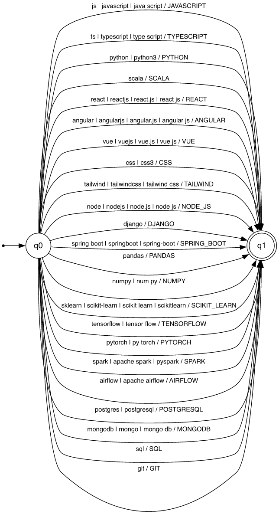

# Qualification Normalization — Finite-State Transducer

Stage 2 of the ResumeLens pipeline, implemented with
[pyformlang](https://pyformlang.readthedocs.io/) (`pyformlang.fst.FST`) in
[`src/normalizer.py`](../src/normalizer.py). It receives the skill strings that
stage 1 extracted, exactly as written ([`regular_expressions.md`](regular_expressions.md)),
and transforms the equivalent spellings of a qualification into one canonical
token (`JS`, `Javascript` → `JAVASCRIPT`). The tokens are then deduplicated and
sorted in the canonical order of each profile, which is the input of the stage-3
automata ([`automata.md`](automata.md)).

## Design

- **Word-level alphabet.** Stage 1 already delimits every string, so each
  extracted string is **one input symbol**. Before translating it, stage 2
  writes the string in the form of the alphabet (`clean`): lowercase, with a
  single space between words. `Tensor Flow`, `tensor  flow` and `TENSOR FLOW`
  are therefore the same input symbol, `tensor flow`.
- **One transducer for the four profiles.** The vocabulary of qualifications is
  shared; what depends on the profile is the canonical order used to sort.
- **Functional.** Every input symbol has exactly one output, and a string
  outside the input alphabet has no transition: the transducer rejects it and
  the string is reported as **unknown** instead of being guessed (FR-12).

## Formal definition

**M = (Q, Σ, Γ, δ, ω, q₀, F)** with

- **Q** = {q₀, q₁}
- **Σ** = the 57 spellings of the table below (the input symbols)
- **Γ** = {JAVASCRIPT, TYPESCRIPT, PYTHON, SCALA, REACT, ANGULAR, VUE, CSS,
  TAILWIND, NODE_JS, DJANGO, SPRING_BOOT, PANDAS, NUMPY, SCIKIT_LEARN,
  TENSORFLOW, PYTORCH, SPARK, AIRFLOW, POSTGRESQL, MONGODB, SQL, GIT}
  (23 canonical tokens, the skill vocabulary of the DSL)
- **δ** : Q × Σ → Q, the transition function: δ(q₀, v) = q₁ for every v ∈ Σ;
  δ is undefined for every other pair (q₁ has no outgoing transitions)
- **ω** : Q × Σ → Γ\*, the output function: ω(q₀, v) = canon(v), the canonical
  token of v in the table below (one output symbol per transition)
- **q₀** = q₀, the initial state
- **F** = {q₁}

| Output (Γ) | Input spellings (Σ) |
|---|---|
| JAVASCRIPT | `js`, `javascript`, `java script` |
| TYPESCRIPT | `ts`, `typescript`, `type script` |
| PYTHON | `python`, `python3` |
| SCALA | `scala` |
| REACT | `react`, `reactjs`, `react.js`, `react js` |
| ANGULAR | `angular`, `angularjs`, `angular.js`, `angular js` |
| VUE | `vue`, `vuejs`, `vue.js`, `vue js` |
| CSS | `css`, `css3` |
| TAILWIND | `tailwind`, `tailwindcss`, `tailwind css` |
| NODE_JS | `node`, `nodejs`, `node.js`, `node js` |
| DJANGO | `django` |
| SPRING_BOOT | `spring boot`, `springboot`, `spring-boot` |
| PANDAS | `pandas` |
| NUMPY | `numpy`, `num py` |
| SCIKIT_LEARN | `sklearn`, `scikit-learn`, `scikit learn`, `scikitlearn` |
| TENSORFLOW | `tensorflow`, `tensor flow` |
| PYTORCH | `pytorch`, `py torch` |
| SPARK | `spark`, `apache spark`, `pyspark` |
| AIRFLOW | `airflow`, `apache airflow` |
| POSTGRESQL | `postgres`, `postgresql` |
| MONGODB | `mongodb`, `mongo`, `mongo db` |
| SQL | `sql` |
| GIT | `git` |

The transducer accepts exactly the one-symbol words of Σ, and its translation
relation is the function

T(M) = { (v, canon(v)) | v ∈ Σ } ⊆ Σ × Γ.

Every spelling of Σ is a string that stage 1 can extract (checked for each one
in `tests/test_normalizer.py`), and together they cover every string the stage-1
skill patterns produce, except the tools no profile uses (Docker, Kubernetes,
AWS, GCP, Terraform).

**Type.** M is a deterministic (sequential) transducer: it has a single initial
state, at most one transition for every pair (state, input symbol), no
ε-transitions, and every transition writes exactly one output symbol.

## Graphical representation

One edge per output token; each edge is labelled *inputs / output*, and stands
for one transition per input spelling.



The diagram is generated from `VARIANTS` by `python src/diagrams.py`
([`diagrams/fst_normalization.dot`](diagrams/fst_normalization.dot)).

## Implementation

```python
fst = FST()
q0, q1 = State("q0"), State("q1")
fst.add_start_state(q0)
fst.add_final_state(q1)
for canonical, spellings in VARIANTS.items():
    for spelling in spellings:
        fst.add_transition(q0, Symbol(spelling), q1, [Symbol(canonical)])

def translate(raw):
    for output in NORMALIZATION_FST.translate([clean(raw)]):
        return "".join(str(symbol) for symbol in output)
    return None          # no transition: the transducer rejects the string
```

`create_normalization_fst()` builds the transducer and `NORMALIZATION_FST` is the
instance the pipeline uses.

## Processing

For the skill strings of a résumé, `normalize(raw_technologies)`:

1. writes each string as an input symbol (`clean`);
2. translates it with the transducer (`translate`);
3. keeps each canonical token once, in order of first appearance (FR-13), so
   `JS`, `Javascript` and `JavaScript` give a single `JAVASCRIPT`;
4. reports the strings without translation as unknown (FR-12).

Then, for every profile, `sort_for_profile(tokens, profile)` keeps the tokens of
the profile's alphabet and sorts them in its **canonical order** (FR-14), so the
result does not depend on the order of the résumé. The canonical order of a
profile is its categories in order ([`src/profiles.py`](../src/profiles.py)):

| Profile | Canonical order |
|---|---|
| `FULL_STACK_DEVELOPER` | JAVASCRIPT, TYPESCRIPT → REACT, ANGULAR, VUE → NODE_JS, DJANGO, SPRING_BOOT → POSTGRESQL, MONGODB, SQL → GIT |
| `MACHINE_LEARNING_ENGINEER` | PYTHON → PANDAS, NUMPY → SCIKIT_LEARN, TENSORFLOW, PYTORCH → POSTGRESQL, SQL → GIT |
| `FRONTEND_DEVELOPER` | JAVASCRIPT, TYPESCRIPT → REACT, ANGULAR, VUE → CSS, TAILWIND → GIT |
| `DATA_ENGINEER` | PYTHON, SCALA → SPARK, AIRFLOW → POSTGRESQL, SQL → GIT |

Example of the assignment — the résumé lists `Git, NodeJS, JS, Postgres, React.js`:

| Step | Result |
|---|---|
| Stage 1 (as written) | `Git`, `NodeJS`, `JS`, `Postgres`, `React.js` |
| Translation | GIT, NODE_JS, JAVASCRIPT, POSTGRESQL, REACT |
| Full Stack canonical order | **JAVASCRIPT, REACT, NODE_JS, POSTGRESQL, GIT** |
| Machine Learning canonical order | POSTGRESQL, GIT |
| Frontend canonical order | JAVASCRIPT, REACT, GIT |
| Data Engineer canonical order | POSTGRESQL, GIT |

The 120 orders in which those five skills can be written all give the same
Full Stack sequence (`tests/test_normalizer.py`).

## Transformations

The transformations of the assignment, all produced by M:

| Input | Output | Input | Output |
|---|---|---|---|
| JS | JAVASCRIPT | pandas | PANDAS |
| Javascript | JAVASCRIPT | sklearn | SCIKIT_LEARN |
| React.js | REACT | scikit learn | SCIKIT_LEARN |
| ReactJS | REACT | Scikit-learn | SCIKIT_LEARN |
| NodeJS | NODE_JS | Tensor Flow | TENSORFLOW |
| Node.js | NODE_JS | TensorFlow | TENSORFLOW |
| Postgres | POSTGRESQL | Py Torch | PYTORCH |
| PostgreSQL | POSTGRESQL | PyTorch | PYTORCH |

The team's own transformations cover the qualifications of the two team-defined
profiles and more spellings of the reference ones: `ts`/`type script` →
TYPESCRIPT, `angular.js` → ANGULAR, `vue.js` → VUE, `css3` → CSS,
`tailwind css` → TAILWIND, `spring-boot` → SPRING_BOOT, `num py` → NUMPY,
`apache spark`/`pyspark` → SPARK, `apache airflow` → AIRFLOW, `mongo db` →
MONGODB, `python3` → PYTHON, among others.

Strings the transducer rejects are reported, not normalized: `Docker` or `AWS`
(extracted as tools, used by no profile) and the unrecognized items of the
skills list, such as `COBOL` in [`data/resumes/bart_simpson.txt`](../data/resumes/bart_simpson.txt).

## Why a word-level transducer

A character-level transducer could read every spelling letter by letter, with a
path of states per spelling (sharing common prefixes) and the output written on
its last transition. Its translation relation would be the same T(M), with
many more states. Because stage 1 already delimits the strings, the word-level
alphabet keeps the transducer, its 7-tuple and its diagram small, while the
regular expressions of stage 1 carry the character-level detail.
